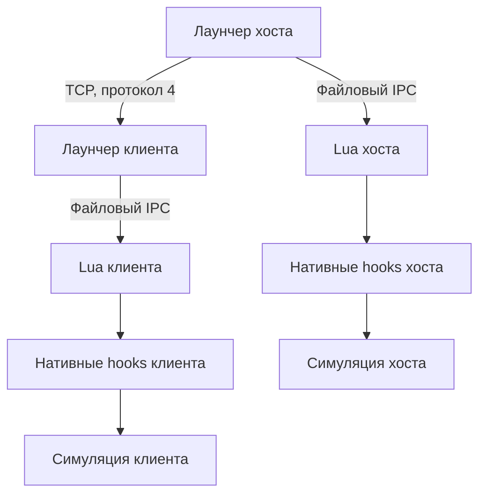

# Архитектура Transport Fever 3 Multiplayer

PR #7 объединён заказчиком в main 47604fbb. [PR #8](https://github.com/WestDed/TransportFever3-Multiplayer/pull/8), от этой main и прямо в main, добавляет постоянного владельца компаний и проверку production net48 runtime. Основа — MPFever 0.3.6, MIT, автор arthur; upstream не изменяется. Игры и сохранений нет: работа компонентов проверена, игровая архитектура ещё не принята.

## Действующая схема

Компьютер хоста запускает игру и C# лаунчер .NET Framework 4.8. Лаунчер слушает TCP, проверяет вход/сообщения, связывает peers с компаниями и пересылает действия. Внешний сервер не требуется; NAT/firewall/WAN не испытаны. Каждый клиент запускает собственную симуляцию общего логического мира.

`launcher/Core.cs` — сообщения, безопасный LuaLit, GameLink, Relay/Client, установка. `NetworkIO.cs` — bounded UTF-8 reader/tail/outboxes. `ProtocolSchema.cs` — client kinds/actions/company bindings; `PeerIdentity.cs` — session credentials и proven owner; `OwnerIdentity.cs` — постоянные RSA profiles, SHA-256 owner, signed challenge и fail-closed file/marker. `Snapshots.cs` — manifest/source/receiver/atomic commit. `MainForm.cs` — lifecycle, clocks/hashes/resync/UI. Native C++ строится в winhttp.dll; hooks/addresses зависят от game build.

Lua common содержит serializer и data-only decoder; bridge связывает GUI, native proposals и simulation state; refs разрешает стабильные ссылки в локальные entity IDs; co ведёт реестр/контракты/кредиты; permissions проверяет fleet/line owners после разрешения refs. ACCOUNT/PLAYER/progression/pathfinding принадлежат движку.

## Компании и общий мир

Стабильный company id передаётся по сети; локальные ent/canon не являются общими IDs. Реестр сохраняется Lua game state. Подпись включает sid, ключ/имя/цвет/id/стартовый бюджет с однозначными границами. Это не Steam authentication.

Host GameLink сообщает roster/readiness/owner/world. Client доказывает владение постоянным RSA key по свежему nonce/session epoch/host fingerprint; owner сохраняется в Lua registry. После restart CompanyBindings восстанавливается по owner независимо от session peer id, имени или sid. Старый save без owner требует явного host-only assignment, scoped by saved world. Session token без соответствующего key не заменяет сокет. Общая progression хоста и monetary corrections upstream сохранены и требуют анализа. Все города/заводы/грузы/пассажиры симулируются в каждой копии; эквивалентность этих миров не доказана без игры.

## Порядок и восстановление

Действующий scheduler сохраняет upstream issuer stamp `at`, Lua/native queues и clocks barrier. Native действие автора могло примениться до server validation. Полного центрального order/epoch/replay-author пока нет.

`CommandJournal`, `ReplayCursor`, `RecoveryBarrier` собраны и проверены отдельно, но не подключены к MainForm scheduler. [ADR 0001](docs/ADR_0001_COMMAND_CUTOVER.md) определяет durability, freeze/frontier/quorum и переход native/GUI. Нельзя считать наличие этих классов работающим игровым lockstep.

Snapshot — read-only source, chunks 256 KiB, SHA-256, bounded per-peer writers, временный файл, атомарная замена. max 1 GiB/4096 parts — предварительные safety limits. Receipt/hello — предварительная готовность, не доказательство правильной геометрии/экономики. Failure блокирует resume до восстановления/окончания сессии; действия на границе save требуют ADR gate.

## Протокол и доверие

UTF-8 строки `kind TAB from TAB payload LF`, payload — ограниченные data-only Lua tables. Protocol 4 согласуется в challenge/signed join до принятия входа; sender определяется сокетом. До принятия join сокет не получает Broadcast/адресные сообщения сессии. Подтверждение connection ставится в очередь до публикации Joined под общим lock; первый frame ограничен 4 КиБ, после него сохраняется общий лимит и уже buffered data. Повторный join, неизвестные join fields, host controls с клиента, malformed types/limits отказывают. Восемь TCP-клиентов (хост играет дополнительно) + четыре ограниченных handshakes, reconnect по credential допускается на полном сервере.

Версия wire не проверяет одинаковость EXE/DLL/mods/game build. TCP не шифруется; initial invitation, server authentication/Steam proof остаются задачами. Межсессионный possession claim реализован; engine save/load/reconnect требует испытаний. Для выпуска нужна подтверждённая identity и матрица game permissions/цены/refs.

История и точные исправления: [декодер](docs/STAGE1_TESTS_DECODER.md), [сеть/снимки](docs/STAGE1_NETWORK_SNAPSHOTS.md), [компании](docs/STAGE1_COMPANIES_PROTOCOL.md), [восстановление/стенд](docs/STAGE1_OFFLINE_RECOVERY.md), [изоляция рукопожатия](docs/STAGE1_HANDSHAKE_ISOLATION.md). Первичный [аудит архитектуры](https://github.com/WestDed/TransportFever3-Multiplayer/blob/6611e8f63e29e04aeb978bddd17877b461894edf/ARCHITECTURE.md) сохранён в Git history.

Постоянный owner, backup и миграция: [STAGE1_PERSISTENT_OWNERSHIP](docs/STAGE1_PERSISTENT_OWNERSHIP.md).
