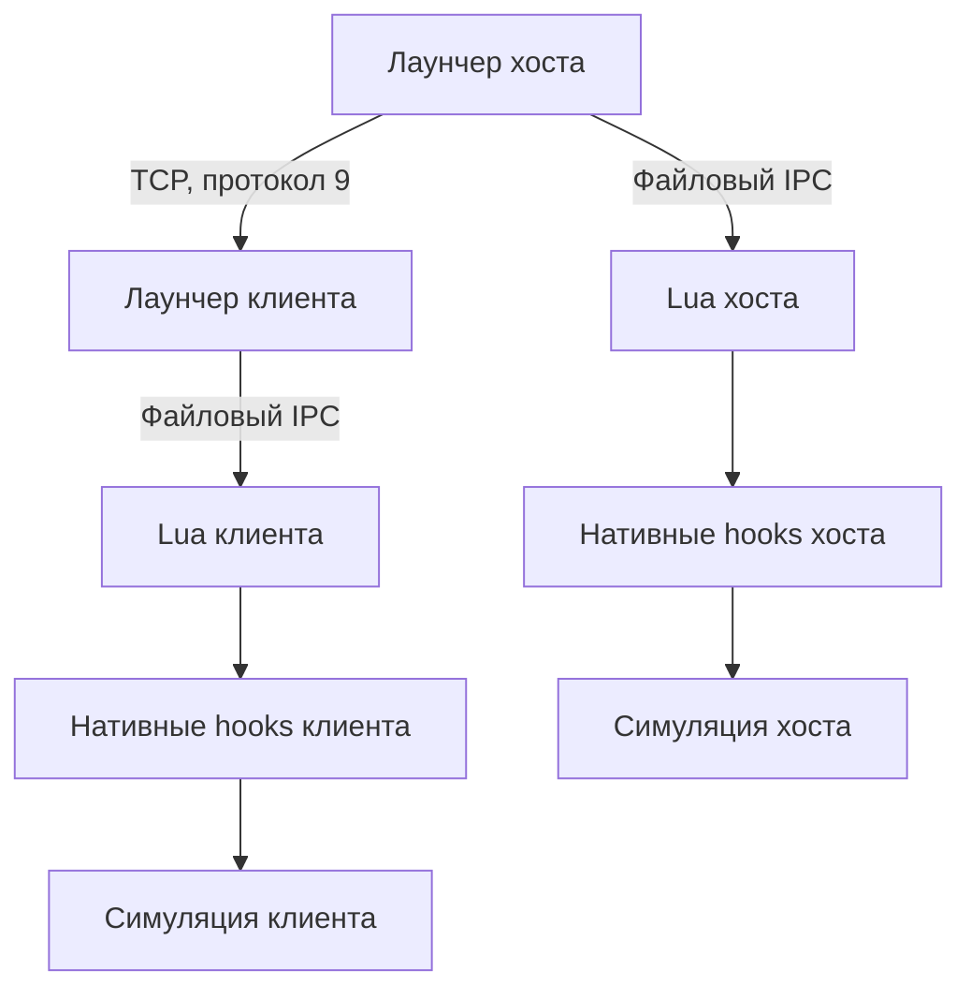

# Архитектура Transport Fever 3 Multiplayer

19.10, .6/protocol 11: [общий файл до запуска и докачка](docs/FASTER_CONNECTIONS.md). waiting → preparing → запуск только после точных receipts; затем отдельный барьер готовности движков. Первый старт не создаёт новый engine snapshot и не перезагружает мир второй раз. Частичный кеш проверяет каждый chunk и полный SHA. Ниже — история .5 и предыдущих решений.

19.10: [лобби и точный кеш снимков](docs/LOBBY_AND_SNAPSHOT_CACHE.md), .5/protocol 10. Нормальный Init теперь открывает лобби без игрового процесса; существующие Relay/Client и порт используются для room/revision/ready. Перед bulk — offer → exact local SHA+atomic commit/receipt либо need → прежние chunks. Подтверждения привязаны к Peer+id+transfer; при уходе клиентов ожидание прекращается. Подробности, ограничения и реальные наблюдения .4 — в документе.

18.10: [snapshot queue backpressure](docs/INCIDENT_2026_10_18_SNAPSHOT_QUEUE.md), пакет .4/protocol 9. BoundedOutbox объединяет pending peerclock/mpstatus только в последнем сегменте между ordered frames. Session changes — отдельные границы порядка; идентичный heartbeat сохраняет прежнюю позицию. FIFO команд/частей snapshot и лимиты 8 MiB/128 frames, включая in-flight, сохранены.

18.10.2026: [исправление вылета загрузки](docs/INCIDENT_2026_10_18_MAP_LOAD.md). `GameScriptState` используется только в получившем его callback. Чужие progression handlers/readers находят `mpfever_1::/mpfever.gs` через `gameScriptSystem` и читают `GAME_SCRIPT.state.co`; engine handle и entity не кешируются между вызовами/мирами. Пакет .3, protocol 8. Ниже — история прежних версий.

16.10.2026, PR #15: [личное развитие компаний](docs/COMPANY_PROGRESSION.md) хранится в `co.progression` по стабильному company id. Собственные XP за транспортные участки, подтверждение уровня, штатные пороги/permits/ticket multipliers, native state mirror и нормализованный hash; GUI получает world-scoped view. Старый общий reader используется до успешного перехода. Новые engine adapters ещё NOT TESTED в TF3; города и городские эффекты остаются общими. Пакет 0.3.7-westded.2-experimental, protocol 7.

15.10.2026. Main `937318b7` содержит PR #10. Заказчик и брат сообщили об успешном startup/join и совместной игре через Porthole; большие карты и часть механик выявили отказы. У разработчика игра/API/saves не установлены. [PR #11](https://github.com/WestDed/TransportFever3-Multiplayer/pull/11) исправляет подтверждённые исходниками/регрессиями дефекты; игровой повтор ещё нужен. Основа — MPFever 0.3.6, MIT, автор arthur; upstream не изменяется.

## Действующая схема

Компьютер хоста запускает игру и C# лаунчер .NET Framework 4.8. Лаунчер слушает TCP, проверяет вход/сообщения, связывает peers с компаниями и пересылает действия. Внешний сервер не требуется; пользователи соединились через TCP proxy Porthole. Другие WAN/NAT/firewall конфигурации не приняты. Каждый клиент запускает собственную симуляцию общего логического мира.

`launcher/Core.cs` — сообщения, безопасный LuaLit, GameLink, Relay/Client, установка. `NetworkIO.cs` — bounded UTF-8 reader/tail/outboxes. `ProtocolSchema.cs` — client kinds/actions/company bindings; `PeerIdentity.cs` — session credentials и proven owner; `OwnerIdentity.cs` — постоянные RSA profiles, SHA-256 owner, signed challenge и fail-closed file/marker. `Snapshots.cs` — manifest/source/receiver/atomic commit. `MainForm.cs` — lifecycle, clocks/hashes/resync/UI. Native C++ строится в winhttp.dll; hooks/addresses зависят от game build.

Lua common содержит serializer и data-only decoder; bridge связывает GUI, native proposals и simulation state; refs разрешает стабильные ссылки в локальные entity IDs; co ведёт реестр/контракты/кредиты; permissions проверяет fleet/line owners после разрешения refs. ACCOUNT/PLAYER/pathfinding принадлежат движку; личный progression хранится модом и проецируется в документированное состояние игры.

## Компании и общий мир

Стабильный company id передаётся по сети; локальные ent/canon не являются общими IDs. Реестр сохраняется Lua game state. Подпись включает sid, ключ/имя/цвет/id/стартовый бюджет с однозначными границами. Это не Steam authentication.

Host GameLink сообщает roster/readiness/owner/world. Client доказывает владение постоянным RSA key по свежему nonce/session epoch/host fingerprint; owner сохраняется в Lua registry. После restart CompanyBindings восстанавливается по owner независимо от session peer id, имени или sid. Старый save без owner требует явного host-only assignment, scoped by saved world. Session token без соответствующего key не заменяет сокет. Monetary corrections upstream сохранены и требуют анализа. Личный progression заменяет общий fallback после совместимого одноразового перехода; до него сохраняется прежний reader. Все города/заводы/грузы/пассажиры симулируются в каждой копии; эквивалентность этих миров не доказана без игры.

## Порядок и восстановление

Действующий scheduler сохраняет upstream issuer stamp `at`, Lua/native queues и clocks barrier. Native действие автора могло примениться до server validation. Полного центрального order/epoch/replay-author пока нет.

`CommandJournal`, `ReplayCursor`, `RecoveryBarrier` собраны и проверены отдельно, но не подключены к MainForm scheduler. [ADR 0001](docs/ADR_0001_COMMAND_CUTOVER.md) определяет durability, freeze/frontier/quorum и переход native/GUI. Нельзя считать наличие этих классов работающим игровым lockstep.

Snapshot — read-only source, chunks 256 KiB, SHA-256, bounded per-peer writers, временный файл, атомарная замена. max 1 GiB/4096 parts — предварительные safety limits. Receipt/hello — предварительная готовность, не доказательство правильной геометрии/экономики. Failure блокирует resume до восстановления/окончания сессии; действия на границе save требуют ADR gate.

## Протокол и доверие

UTF-8 строки `kind TAB from TAB payload LF`, payload — ограниченные data-only Lua tables. Protocol 9 согласуется в challenge/signed join до принятия входа; sender определяется сокетом. До принятия join сокет не получает Broadcast/адресные сообщения сессии. Подтверждение connection ставится в очередь до публикации Joined под общим lock; первый frame ограничен 4 КиБ, после него сохраняется общий лимит и уже buffered data. Повторный join, неизвестные join fields, host controls с клиента, malformed types/limits отказывают. Восемь TCP-клиентов (хост играет дополнительно) + четыре ограниченных handshakes, reconnect по credential допускается на полном сервере.

Версия wire не проверяет одинаковость EXE/DLL/mods/game build. TCP не шифруется; initial invitation, server authentication/Steam proof остаются задачами. Межсессионный possession claim реализован; engine save/load/reconnect требует испытаний. Для выпуска нужна подтверждённая identity и матрица game permissions/цены/refs.

История и точные исправления: [декодер](docs/STAGE1_TESTS_DECODER.md), [сеть/снимки](docs/STAGE1_NETWORK_SNAPSHOTS.md), [компании](docs/STAGE1_COMPANIES_PROTOCOL.md), [восстановление/стенд](docs/STAGE1_OFFLINE_RECOVERY.md), [изоляция рукопожатия](docs/STAGE1_HANDSHAKE_ISOLATION.md). Первичный [аудит архитектуры](https://github.com/WestDed/TransportFever3-Multiplayer/blob/6611e8f63e29e04aeb978bddd17877b461894edf/ARCHITECTURE.md) сохранён в Git history.

Постоянный owner, backup и миграция: [STAGE1_PERSISTENT_OWNERSHIP](docs/STAGE1_PERSISTENT_OWNERSHIP.md).

PR #9 проверяет owner uniqueness по всем roster rows, включая pending entities; заменяет roster и bindings только после полного успешного расчёта. Invalid report блокирует новые права до корректного полного report. Sid можно обновить с прежним proven owner. Lua helper назначения требует valid host owner/approver и world. [Результаты проверки main](docs/MAIN_REVIEW_2026_10_13.md).

## Первое совместное испытание и все замечания PLAY-01–08

[Отчёт пользователей и история исправлений](docs/COOP_PLAYTEST_2026_10_15.md), [архитектура и инструкция новых соглашений](docs/BUSINESS_MECHANICS.md). В PR #11 реализованы и подключены права use/connect/edit, режимы private/free/toll для дорог и остановок, saved toll visits и последовательные journal legs, собственные заказы с escrow/одним carrier/фактической доставкой/возвратом, GUI company-notification projection и фильтр денежных позиций отдельного GUI world после native replication. Клиент не получает новые owner/journal команды; отправляет bounded business event, co/request назначает bridge.

Геометрические ключи связывают разрешённые split segments с исходной дорогой. Road с connect становится engine-public, но logical owner/ACL сохраняется, а содержание начисляется ему отдельно. Политика проверяется перед replay и в author native capture; реальная возможность остановить native proposal до apply требует игрового gate. Engine имеет одного владельца без ACL: UI-флаг сам по себе прав не обеспечивает.

`co.business` сохраняет права, заказы, visit/delivery dedup и платежи. `business` hash проверяет общие условия и progress без локальных tokens/callback markers; ACCOUNT проверки остаются. Saved in-flight booking блокируется как uncertain после reload: это защита от повторного списания, а не доказанная атомарность save+native journal.

Загрузка мира после verified transfer имеет отдельную liveness: каждые 10 секунд launcher сообщает точный snapshot/phase; soft budget 30 минут продлевается до абсолютных двух часов при живой связи. Ready отдельно привязан к snapshot после нового game hello. Healthy socket при незавершённой engine load не закрывается автоматически. Это реакция на уточнённый отказ 50% в игровом loading screen, не доказанная причина зависания движка.

Центральный replay/cutover не заменён, новые native offsets не добавлены. Все новые механики — экспериментальная реализация; игровой результат **NOT RETESTED**.
